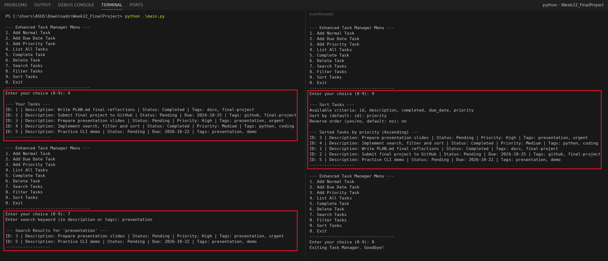

# Week 12: Final Project Development & Presentation
## Enhanced Task Manager CLI (Final Version)

ผู้จัดทำ: เมธาวี สิทธิชัยเนตร, รหัสนักศึกษา 663380372-6

Enhanced Task Manager เวอร์ชันสมบูรณ์ ต่อยอดจากการออกแบบใน Week 11 ทำครบทุกฟีเจอร์ ได้แก่ **tags, search, filter และ sort** โดยแบ่งเป็นโมดูลตามหน้าที่ (Separation of Concerns) รายละเอียดการออกแบบ ปัญหาที่เจอ และบทเรียนอยู่ใน **[PLAN.md](PLAN.md)**

## 📸 Screenshot: ผลการรัน (เลือก 3 ตัวเลือก)
1. **4. List All Tasks**: แสดงงานทั้งหมด 5 งาน (Normal / Due Date / Priority พร้อม tags)
2. **7. Search Tasks**: ค้นหา `presentation` เจอ 2 งาน (ค้นทั้ง description และ tags)
3. **9. Sort Tasks**: เรียงตาม `priority` (High, Medium แล้วตามด้วยงานที่ไม่มี priority)



## Features
| เมนู | ความสามารถ |
|---|---|
| 1-3 | เพิ่มงาน Normal / Due Date / Priority พร้อม tags (ตรวจรูปแบบวันที่และ priority) |
| 4 | แสดงงานทั้งหมด |
| 5 / 6 | Complete / Delete ด้วย ID (ป้อนค่าที่ไม่ใช่ตัวเลขก็ไม่ crash) |
| 7 | **Search**: หาคำใน description และ tags (ไม่สนตัวพิมพ์เล็ก-ใหญ่, จับคำบางส่วนได้) |
| 8 | **Filter**: สถานะ, due date ก่อน/หลัง, priority และ tags (ต้องมีครบทุก tag) ใช้หลายเงื่อนไขพร้อมกันได้ |
| 9 | **Sort**: id, description, completed, due_date, priority (เรียงจากมากไปน้อยได้) |

ข้อมูลบันทึกลง `data/tasks.json` อัตโนมัติ โปรเจกต์มีงานตัวอย่าง 5 งานไว้สำหรับ demo (ตามคำแนะนำ "Have a few pre-prepared tasks")

## How to Run
```bash
python main.py
```
ใช้แค่ Python standard library จึงไม่ต้องติดตั้งอะไรเพิ่ม

## Project Structure
```
Week12_FinalProject/
├── src/
│   ├── __init__.py
│   ├── task.py               # Task, DueDateTask, PriorityTask (with tags)
│   ├── data_persistence.py   # JSON load/save (rebuilds the right task type from _type)
│   ├── task_manager.py       # Business logic: CRUD + search, filter, sort
│   └── cli_interface.py      # Menu, input validation, output
├── data/
│   └── tasks.json            # Pre-seeded demo tasks
├── screenshots/
│   └── run_result.png
├── main.py                   # Entry point / orchestrator
├── .gitignore
├── README.md
└── PLAN.md                   # Plan, implementation notes, challenges, reflections
```

## สิ่งที่แก้จาก starter code
* `main.py` เดิมใช้ `from task_manager import TaskManager` หลังเพิ่ม `src/` ลงใน path แต่โมดูลใน `src/` ใช้ relative import (`from .task import ...`) ทำให้เจอ `ImportError` ตอนเปิดโปรแกรม จึงแก้เป็น `from src.task_manager import TaskManager`
* `__str__` ของ `DueDateTask` และ `PriorityTask` เดิมแสดง `Tags:` ตามด้วยเว้นวรรค 2 ช่อง แก้ให้เหลือ 1 ช่อง
* `search_tasks` เทียบ tag แบบไม่สนตัวพิมพ์ (`tag.lower()`) ให้ตรงกับคำอธิบายในใบงาน
